# Building the Lidar port

You build the Lidar port of [LibreEcho](https://github.com/aslater3/LibreEcho) from a fresh
clone of this repository. The build runs inside a pinned container image, so the host needs
podman and a few standard tools, not a compiler toolchain.

**Status.** The clean-clone path has host evidence only. Nothing here is a support claim.
[docs/status.md](docs/status.md) gives the current state and
[docs/install-new-lidar.md](docs/install-new-lidar.md) covers the device side.

## Quickstart

From a fresh clone:

1. **Prepare the workspace.**

   ```sh
   git clone https://github.com/TomGrozev/libreecho-lidar-port && cd libreecho-lidar-port
   python3 tools/workspace.py init
   ```

   This clones the forks named by [integration.json](integration.json), rebuilds the
   integration branches and their lock, prepares the build image, and fetches the public
   build inputs into `work/inputs/`.

   The build image comes from `build_image` in [tools/lab-build.json](tools/lab-build.json).
   With a digest it is pulled as `name@digest`. With a null digest, `init` builds the local
   tag `libreecho-build:local` from the product's
   `build/container/Containerfile`. `--build-image` forces the local build;
   `--no-image` skips this step. The image carries the Ubuntu 24.04 CI runner baseline,
   the host packages, and CPython 3.11.

2. **Generate the OTA signing key pair.**

   ```sh
   python3 tools/workspace.py keygen
   ```

   This writes an ed25519 key pair at the paths `private/local.json` names
   (`private/keys/ota-lab/` by default).

3. **Point `private/local.json` at your own stock boot image.** Create
   `private/local.json` from [tools/local.example.json](tools/local.example.json) and set
   `stock_boot` to your own `boot_a` backup, the readback that `lidar_prepare.py backup`
   produces on the device ([docs/install-new-lidar.md](docs/install-new-lidar.md), the
   `backup` stage). Set `device_host` too if you know the device's Wi-Fi adb address.

4. **Check the workspace.**

   ```sh
   python3 tools/workspace.py doctor
   ```

   You get one list of everything still missing: host tools, podman and the build image,
   free disk below 20 GB, clones, branches, inputs, and empty `private/local.json` entries.
   Keep running it until the list is empty.

5. **Build the lab OTA.**

   ```sh
   python3 tools/lab-build.py build
   ```

   The build runs in the pinned image and writes the deliverables under
   `work/builds/v<version>/`: the signed OTA bundle (`libreecho-*.ota.tar`), `SHA256SUMS`,
   `provenance.json`, the product run and the logs. The version defaults to the highest
   existing build plus one patch; pass `--version X.Y.Z` for the first build. The step is
   host-only and never touches a device.

6. **Deploy (optional; writes the device).**

   ```sh
   python3 tools/lab-build.py deploy <version> --host <device>:5555 --yes
   ```

   This installs the OTA on the device's inactive boot slot over Wi-Fi adb, reboots, and
   polls until the device reports the expected generation. Each deploy is a hardware write
   and reboot, so each one needs your approval; the command refuses without `--yes`.

## The pipeline



## Host prerequisites

The build image provides the compilers, the cross toolchains and python3.11. The host needs:

- Linux x86_64; the image is amd64 only.
- `python3` and `python3.11`. The pinned mbedTLS wheel closure targets CPython 3.11.
- `git`, `curl`, `make`, `dpkg-deb` and `rsync`. `workspace.py doctor` checks each one.
- `podman`. The build runs rootless in the image.
- About 20 GB of free disk for the image, the inputs and the build output.
- `adb` over Wi-Fi for `deploy`.

Network access is needed for the first `init`: it clones the forks and fetches the inputs by
URL and sha256.

## Workspace tiers

Two gitignored directory trees sit beside the repository files:

| Tier | Holds | Why |
| --- | --- | --- |
| `work/` | `work/forks/<repo>`, `work/integration/<repo>` with `integration.lock.json`, `work/inputs/`, `work/product-build/`, `work/builds/` | Regenerable. `workspace.py init` recreates the clones, the integration worktrees, the image and the fetched inputs; a build recreates the rest. |
| `private/` | `private/local.json` (input paths), the OTA signing keys and the stock boot backup | Private material. It holds per-unit vendor firmware and private keys, so it is never published and never committed. |

`private/local.json` is created from [tools/local.example.json](tools/local.example.json)
and names `ota_signing_key`, `ota_public_key` and `stock_boot`, plus the optional
`device_host`.

## Private inputs

Two build inputs cannot come from the repository:

- **The stock boot image** (`stock_boot`): your own readback of the device's `boot_a`
  partition, produced by the `backup` stage of `lidar_prepare.py` (see
  [docs/install-new-lidar.md](docs/install-new-lidar.md)). The MT8167 image builder
  re-frames this stock image rather than synthesising one, so the bytes must come from the
  exact device model. These are per-unit vendor firmware; redistributing them is not
  cleared, so they stay out of git.
- **The OTA signing key pair** (`ota_signing_key`, `ota_public_key`): generated locally by
  `python3 tools/workspace.py keygen`. The signing key is private and must never be
  committed or shared; the public key is installed into the image and travels with the
  bundle.

A build refuses to start without both. No public release carries them, which is also why the
Lidar target stays a local build.

## What `lab-build.py build` runs

`python3 tools/lab-build.py build` holds a lock on `work/builds/.build.lock`, rebuilds the
per-repo integration branches with `tools/integrate.py` and verifies the lock, then drives
the product's own build (`build/build.sh --target lidar --profile ota --no-publish`) from
the LibreEcho integration worktree inside the pinned image. It writes the signed OTA and its
provenance under `work/builds/v<version>/`.

Each build is an attempt directory named by its version and a source id. A successful
attempt with the same source id is reused on the next run; pass `--rebuild` to build again.
Failed attempts stay under `work/builds/` for inspection, and the five newest are kept. A
promoted build is `work/builds/v<version>/`.

The other options:

- `--no-integrate` skips the integration rebuild.
- `--lock PATH` reads another lock and implies `--no-integrate`.
- `--no-container` builds with the host toolchain instead of the image.
- `--stock-boot`, `--ota-signing-key` and `--ota-public-key` override
  `private/local.json`.

The full environment variable list for the product build (build roots, toolchain
variables, the stock boot and key paths, the OpenThread Border Router source) is
authoritative in the product fork's `build/README.md`, section "Building Lidar locally";
read it at `work/forks/LibreEcho/build/README.md` after `init` rather than copying values
from here.

`deploy` installs a finished build over Wi-Fi adb: it rechecks the deliverables against
`provenance.json`, seeds the device's content-addressed asset cache, has the device assemble
the generation from the signed manifest without network access, installs the OTA on the
inactive slot, reboots and polls until the device reports the expected generation. Each
deploy is a hardware write and reboot; the command refuses without `--yes`.

## Building is the host side

The device side, from a stock Echo Plus 2nd Gen to a running LibreEcho install, is
[docs/install-new-lidar.md](docs/install-new-lidar.md). No fresh unit has run that path end
to end yet, and the guide marks which steps are not hardware-proven.
