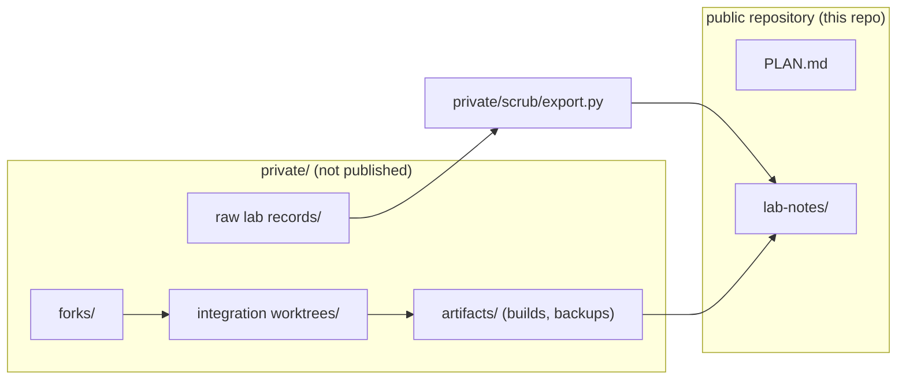
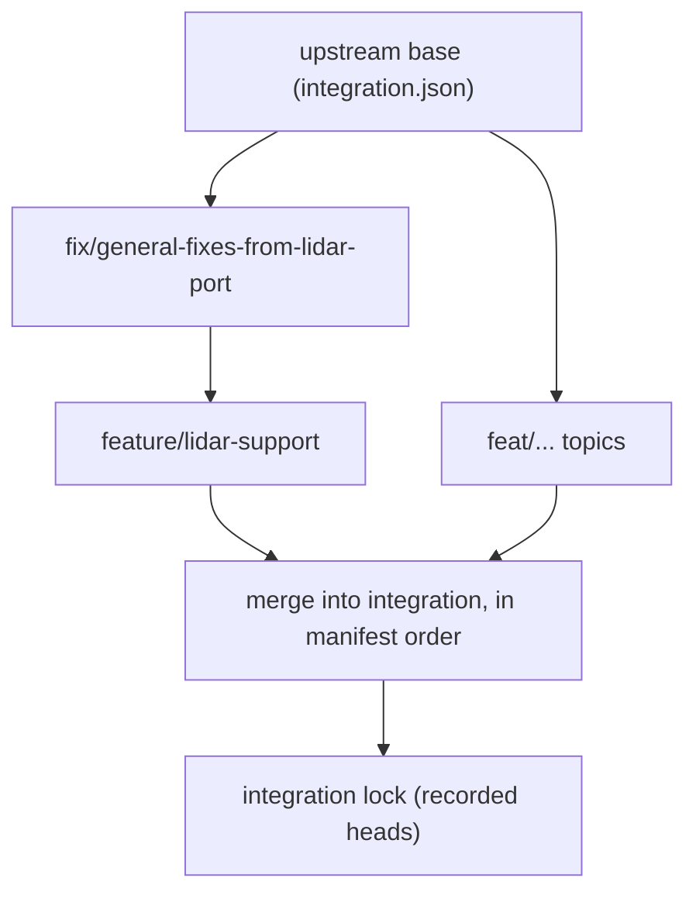
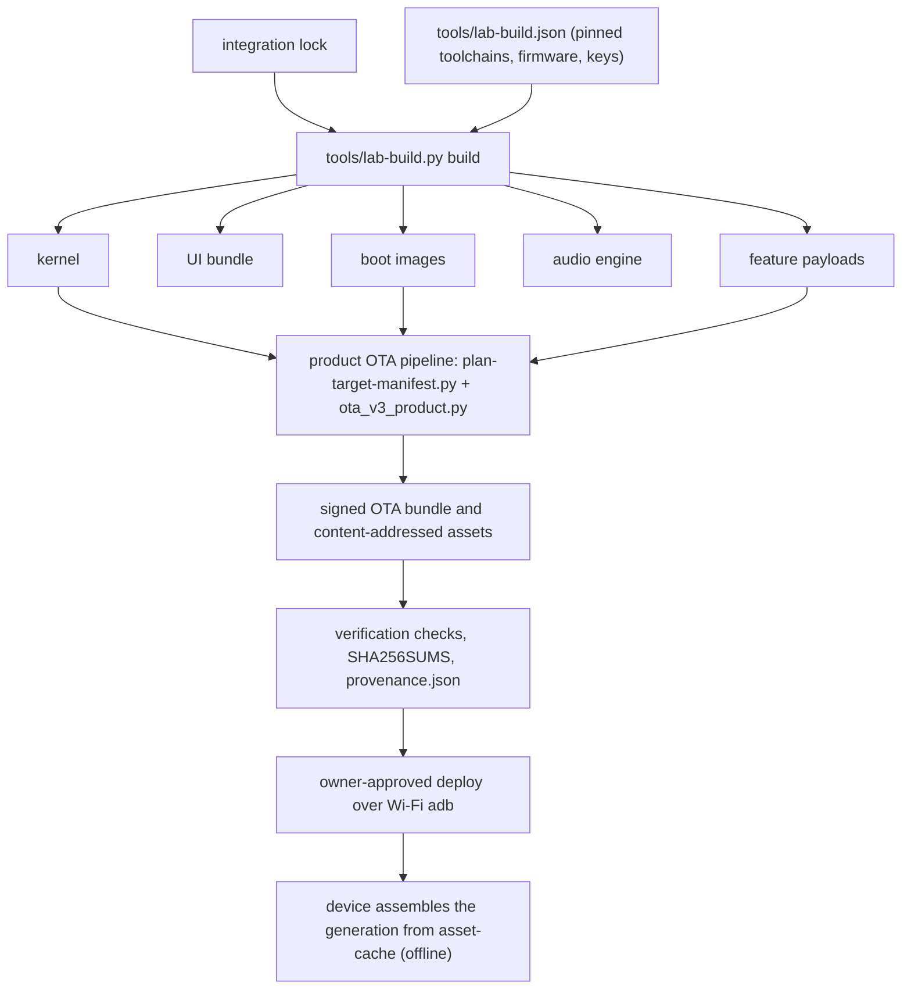

# LibreEcho on the Echo Plus 2nd Gen (Lidar): port archive

This repository is the plan and evidence archive of the port of
[LibreEcho](https://github.com/aslater3/LibreEcho) to the Echo Plus 2nd Gen. LibreEcho is
free firmware that replaces Amazon's software on Echo speakers. The device codename is
Lidar and its system-on-chip is a MediaTek MT8167. The work ran against one development
unit. The repository keeps the phase plan, the experiment notes and the measurement
results, with device and owner identifiers replaced by placeholders (see
[SCRUB.md](SCRUB.md)); the raw, unscrubbed lab material stays under `private/`, which is
not part of the repository.

## Status

The port is experimental and not released. Hardware results come from one development
unit, and the upstream product does not yet ship a Lidar target. Nothing here is a
support claim.

| Phase | Name | State |
| --- | --- | --- |
| 0 | Experimental workspace | done |
| 1 | Read-only boot-chain inventory | done |
| 2 | Boot-chain construction and restore tooling | done |
| 3 | Owner access and fastboot | done |
| 4 | Kernel and DTB bring-up | done |
| 5 | Platform, install, recovery, OTA | done |
| 6 | Hardware and core feature bring-up | done |
| 7 | Product integration and production tooling | in progress |
| 8 | Validation and PR preparation | not started |

Each phase passed its gate before the next one started; [PLAN.md](PLAN.md) is the
authoritative record of scope, gates and decisions. The phase records in
[`lab-notes/`](lab-notes/README.md) hold the evidence.

## What works on hardware

Each row links to the evidence directory. "Works" means the feature was demonstrated on
the development unit. It does not mean released or supported. The paths point into
`lab-notes/`, the scrubbed copy of the lab workspace's phase records.

| Area | State | Evidence |
| --- | --- | --- |
| Boot chain (owner access) | Owner-access chain built from the reference kit's hardware-proven Kaeru and Koboreru stages, installed after a stock backup, a restore drill and readback checks. BOOT1 was never written. The same chain built from source is not yet hardware-proven. | [`lab-notes/phase-03/`](lab-notes/phase-03/) |
| Kernel | Source-built ARM64 Linux 6.18.64 boots from a boot slot on the device. | [`lab-notes/phase-06/hw-20261121/`](lab-notes/phase-06/hw-20261121/) (steps 3-9) |
| Wi-Fi | MT7668 SDIO driver ported to 6.18 from lidar-mainline's port of Amazon's GPL gen4 driver. DHCP, DNS, link flap and supplicant restart all pass. | [`lab-notes/phase-06/hw-20261121/step11-net/`](lab-notes/phase-06/hw-20261121/step11-net/) |
| Bluetooth | Mainline `btmtksdio`; owner phone paired, A2DP and AVRCP work. | [`lab-notes/phase-06/hw-20261121/step26-bt/`](lab-notes/phase-06/hw-20261121/step26-bt/) |
| Audio playback | Two-way speaker through the TLV320 AIC32x4, with Amazon's crossover biquads; volume cues and music heard on the product path. | [`lab-notes/phase-06/hw-20261121/step16-audio/`](lab-notes/phase-06/hw-20261121/step16-audio/), [`step21-cue/`](lab-notes/phase-06/hw-20261121/step21-cue/), [`step22-drain/`](lab-notes/phase-06/hw-20261121/step22-drain/) |
| Microphones | All 7 microphones capture; each lane verified by a per-mic rub test. | [`lab-notes/phase-06/hw-20261121/step17-mics/`](lab-notes/phase-06/hw-20261121/step17-mics/) |
| Buttons and LEDs | Volume, mute and Action keys, the 36-channel LED ring, volume meter, mute ring and boot animation. | [`lab-notes/phase-06/hw-20261121/step18-buttons/`](lab-notes/phase-06/hw-20261121/step18-buttons/), [`step19-flash/`](lab-notes/phase-06/hw-20261121/step19-flash/) |
| Privacy latch | While latched, capture is exactly zero on every lane and the ring shows a steady red; capture returns on release. | [`lab-notes/phase-06/hw-20261121/step17-mics/`](lab-notes/phase-06/hw-20261121/step17-mics/), [`step19-flash/`](lab-notes/phase-06/hw-20261121/step19-flash/) |
| UI and control API | Web setup page, bootstrap and authenticated API pass; the LibreEcho feature sweep passed with classified gaps. | [`lab-notes/phase-06/hw-20261121/step13-ui/`](lab-notes/phase-06/hw-20261121/step13-ui/), [`step29-features/`](lab-notes/phase-06/hw-20261121/step29-features/) |
| OTA, A/B updates | True A/B with LK tries fallback; installs, health confirms and a forced-rollback test all passed, including over Wi-Fi without USB. | [`lab-notes/phase-05/`](lab-notes/phase-05/), [`lab-notes/phase-06/wifi-dev-updates/`](lab-notes/phase-06/wifi-dev-updates/) |
| Voice | Wake word and Home Assistant satellite voice commands work; speech-to-text runs on the device. The online assistant reply needs internet and was not tested. | [`lab-notes/phase-06/hw-20261121/step24-voice/`](lab-notes/phase-06/hw-20261121/step24-voice/), [`step29-features/`](lab-notes/phase-06/hw-20261121/step29-features/) |
| EFR32 radio (Zigbee/Thread) | Gecko bootloader answered; the OpenThread RCP and the stock Zigbee NCP each ran on the radio. The permanent Thread service is deferred to Phase 7. | [`lab-notes/phase-06/hw-20261121/step25-efr32/`](lab-notes/phase-06/hw-20261121/step25-efr32/) |

## How the port is built

The port lives in the owner's forks of the LibreEcho repositories, and this repository
holds the workspace that turns the forks into a tested build. The workspace separates
what is published here from the private lab material, and generates the published notes
from the private records:

`lab-notes/` is not written by hand. `private/scrub/export.py` copies the phase records
from the private lab workspace, replaces device and owner identifiers with stable
placeholders, and the scan reports zero hits before publishing. [SCRUB.md](SCRUB.md)
records what was removed and what was kept on purpose.

Each repository in the manifest has one upstream base ref. The topic branches sit on
that base, and the Lidar topic stacks on the general fixes so the fixes can reach the
MT8163 boards separately:

[integration.json](integration.json) lists, per repository, the base and the topics in
merge order. `python3 tools/integrate.py rebuild` recreates the `integration` branch
from the base, merges each topic with `--no-ff` in that order, and writes a lock file
with every recorded head. `check-lock` verifies the lock against the worktrees. A build
refuses to start from a dirty or stale integration branch.

The lab build then turns the locked integration heads into a signed OTA from pinned
inputs, and the owner installs it on the device:

`python3 tools/lab-build.py build` verifies every pinned input in
[tools/lab-build.json](tools/lab-build.json) against its sha256, runs the rebuild and
`check-lock` first, then produces the boot images, the UI bundle, the audio engine and
the feature payloads. It hands them to the product's own OTA pipeline from the LibreEcho
integration worktree (`build/ci/plan-target-manifest.py --target lidar`, then
`build/ci/ota_v3_product.py` with the lab key), so the lab build is an ordinary product
dev build under the tag `radar-puffin-build-<sha7>-<source_id16>-<build_id16>`. The
output directory carries the signed tar, the pipeline's run directory and
`ota-assets/`, plus `SHA256SUMS` and a `provenance.json` that records every source head
and input. A failing check fails the build. Deploy is a separate, owner-approved step:
`lab-build.py deploy` rechecks the deliverables, seeds the device's content-addressed
asset cache, has the device assemble the generation from the signed manifest without
network access, installs the OTA on the inactive slot, reboots, and polls until the
device reports the expected generation. Build never talks to the device.
[docs/agents/integration-and-builds.md](docs/agents/integration-and-builds.md)
holds the layout, the commands and the recipes for all of this.

## Known issues

- Phase 7 is not finished and Phase 8 has not started: there is no production installer
  path yet and no upstream PR.
- The stock boot-chain restore path after Kaeru installation needs a separately reviewed
  BROM procedure; never restore `expdb` alone ([PLAN.md](PLAN.md), "Boot-chain safety").
- A Home Assistant announcement can flash the ring pink and play no audio. The
  host-side cause is narrowed and a fix exists, but the fix is unverified on the device
  ([`lab-notes/phase-07/announce-bug/notes.md`](lab-notes/phase-07/announce-bug/notes.md)).
- A microphone mute from Home Assistant or the web UI is a software mute. The ring turns
  red, but the lamp in the mute button stays dark, because only the hardware latch can
  light that lamp on Lidar. A press of the button then engages the latch. A second press
  releases the latch and also clears the software mute. The owner decided to keep this
  behavior; stock GPIO107 could let software engage the latch, but nobody has tested it
  on this unit ([`lab-notes/phase-07/mute-lamp.md`](lab-notes/phase-07/mute-lamp.md)).
- The test network has no internet access, so internet features (online assistant reply,
  radio, news, NTP) were not tested. They are not counted as failures.
- The board has no real-time clock, so the clock restarts at 1970 after a power cut.
- USB storage is not available (the port works only as a USB device, not as a host) and
  Spotify Connect has no daemon in any LibreEcho image.

## Where to start

Read in this order:

1. This page, for the process, the result and the known issues.
2. [`lab-notes/README.md`](lab-notes/README.md), for the phase layout and the evidence
   rules.
3. [PLAN.md](PLAN.md), the authoritative record of scope, phases, gates and decisions.
4. [docs/agents/integration-and-builds.md](docs/agents/integration-and-builds.md), for
   how the branches and builds fit together.
5. The phase README under `lab-notes/phase-XX/` for the area you care about.

The repository holds:

- `PLAN.md`, the plan and decision record.
- `lab-notes/`, the published phase records: notes, logs, results and the scripts used,
  generated from the private lab workspace by `private/scrub/export.py`.
- `docs/agents/integration-and-builds.md`, how the forks, integration branches and lab
  OTA builds fit together.
- [integration.json](integration.json), the branch manifest, and the tools that consume
  it (`tools/integrate.py`, `tools/lab-build.py`, [tools/lab-build.json](tools/lab-build.json)).
- `GLOSSARY.md`, the project terms.
- `SCRUB.md`, the redaction record, `NOTICE.md`, the third-party licence notes, and
  `LICENSES/`, the full licence texts.
- `AGENTS.md` and `PRESERVATION.md`, the working contract and its safety boundaries.

Everything private (device dumps, built images, repository forks, third-party reference
material, the mtkclient checkout, the raw lab notes and the scrub map) lives under
`private/`, which is excluded from the repository.

## How this port was worked

The owner ran the port with AI coding agents under a written contract,
[AGENTS.md](AGENTS.md). The contract's "Main" is the agent session that plans and
coordinates; the other agents execute phases and report evidence back. Every hardware
write and reboot needed separate approval from the owner, and agent results marked
`[INFERENCE]` are conclusions the agent drew rather than recorded measurements.

## Safety

Porting an Echo device means writing to its boot chain. A bad write to BOOT0, BOOT1,
`expdb` or the tee partitions can brick the unit, and on this device there is no UART to
recover with. The boot-chain rules follow from that: read-only inspection first, a
verified stock backup and restore drill before the first write, readback verification
after every write, and a separate approval for each hardware write or reboot. See
[PRESERVATION.md](PRESERVATION.md) for the purpose and the boundaries, and
[PLAN.md](PLAN.md), "Boot-chain safety", for the rules.

## Related repositories

- Upstream product: [aslater3/LibreEcho](https://github.com/aslater3/LibreEcho).
- The owner's forks hold the Lidar branches:
  [TomGrozev/LibreEcho-Platform](https://github.com/TomGrozev/LibreEcho-Platform),
  [TomGrozev/LibreEcho-UI](https://github.com/TomGrozev/LibreEcho-UI),
  [TomGrozev/LibreEcho-Linux](https://github.com/TomGrozev/LibreEcho-Linux),
  [TomGrozev/kaeru](https://github.com/TomGrozev/kaeru) and
  [TomGrozev/amonet-koboreru](https://github.com/TomGrozev/amonet-koboreru).
- Each fork carries the port as topic branches on the current upstream base; the
  workspace's [integration.json](integration.json) lists them in merge order. Lidar work
  is on `feature/lidar-support` in every repository. In Platform, UI and Linux the Lidar branch
  is stacked on `fix/general-fixes-from-lidar-port`, which holds the fixes that also help
  MT8163 boards. The wake-word model support is on its own branches: Platform
  `feat/wake-layernorm-ops`, UI `feat/wake-word-selection` and LibreEcho
  `feat/wakeword-convert`. None of these branches is merged upstream.

## Privacy and redaction

Device and owner identifiers in the lab workspace are replaced with stable
placeholders when `lab-notes/` is generated, and the scan reports zero hits before
publishing. [SCRUB.md](SCRUB.md) records what was removed, what was kept on purpose, and
the full placeholder table.

## License

Documentation, notes and logs are licensed under CC BY 4.0. Scripts and source files
written for this port are licensed under MIT. See [LICENSE](LICENSE),
[NOTICE.md](NOTICE.md) for third-party material, and the `LICENSES/` directory for the
full texts.
