# LibreEcho on the Echo Plus 2nd Gen (Lidar)

[LibreEcho](https://github.com/aslater3/LibreEcho) is free firmware that replaces Amazon's
software on Echo speakers. This repository is the public record of my port of LibreEcho to
the Echo Plus 2nd Gen (codename **Lidar**, MediaTek MT8167): the plan, the documentation and
the lab evidence. I worked against one development unit.

> [!WARNING]
> This port is experimental and not released. All hardware results come from one
> development unit; nothing here is a support claim. Installing it writes to the boot
> chain, and a bad write can brick the unit with no UART recovery.

Quick links: [Status](docs/status.md) | [Install on a new unit](docs/install-new-lidar.md)
| [Acceptance test](docs/acceptance-test.md) | [Build from source](BUILDING.md) |
[Plan](docs/plan.md) | [Lab notes](lab-notes/README.md)
| [Boot-chain safety](docs/boot-chain-safety.md) | [Glossary](GLOSSARY.md)

## Status

The port works on the development unit. A custom boot chain installs after a stock backup
and restore drill. A source-built 6.18 kernel boots from a slot with Wi-Fi, Bluetooth, audio,
all 7 microphones, buttons and the LED ring, the privacy latch, the web UI and control API,
A/B OTA with automatic fallback, wake word and Home Assistant voice. It is not a supported
product. Phase 7 and Phase 8 of the plan are open: a fresh unit has not run the install guide
end to end, the source-built chain stages are not hardware-proven, and the topic branches
are pushed to my forks with no upstream PR open yet. [docs/status.md](docs/status.md) lists
what works, what does not, and the evidence for each entry.

## How it fits together

A stock unit runs Amazon's signed boot chain: the BROM hands off to a preloader, then to the
LK bootloader. The port replaces LK with **Kaeru**, a custom bootloader that provides
fastboot, and uses **Koboreru**, a payload the signed preloader loads to patch the chain in
RAM. `lidar_prepare.py` installs this chain after backing up the stock partitions. From
fastboot, the LibreEcho installer (`--target lidar`) writes LibreEcho to the boot slots, and
updates arrive as A/B OTA.

Terms are in [GLOSSARY.md](GLOSSARY.md). The rules that apply to every hardware write are in
[docs/boot-chain-safety.md](docs/boot-chain-safety.md).

## Install and build

The device walkthrough is [docs/install-new-lidar.md](docs/install-new-lidar.md). It covers
BROM entry, backup, the restore drill, the boot-chain install, the product installer and
validation. Parts of it are not hardware-proven, and the guide marks which.

The build from a fresh clone is [BUILDING.md](BUILDING.md). It uses a pinned container image,
so a Linux host needs podman and a few standard tools, not a full toolchain.

## Repository layout

| Path | What it holds |
| --- | --- |
| [docs/status.md](docs/status.md) | What works, what does not, and the evidence. |
| [docs/plan.md](docs/plan.md) | The port plan: scope, phases, gates, decisions. |
| [docs/boot-chain-safety.md](docs/boot-chain-safety.md) | The rules for every boot-chain write. |
| `lab-notes/` | The phase records: notes, logs and results. Generated; do not edit by hand. |
| [BUILDING.md](BUILDING.md), [docs/agents/](docs/agents/) | The build guide and the contributor documentation. |
| [integration.json](integration.json), `tools/` | The fork and branch manifest, and the scripts that use it. |
| [PRESERVATION.md](PRESERVATION.md), [AGENTS.md](AGENTS.md) | The project's purpose and the contributor contract. |
| [GLOSSARY.md](GLOSSARY.md), [SCRUB.md](SCRUB.md) | Project terms; the redaction record and placeholders. |
| [NOTICE.md](NOTICE.md), `LICENSES/` | Third-party licence notes and full licence texts. |

## License

Documentation, notes and logs are licensed under CC BY 4.0; scripts and source files written
for this port under MIT. See [LICENSE](LICENSE) and [NOTICE.md](NOTICE.md).
