# Installing LibreEcho on a new Echo Plus 2nd Gen (Lidar)

You start with a stock Echo Plus 2nd Gen (codename `lidar`, MediaTek MT8167) and
finish with a running LibreEcho install. You back up the stock boot chain, read
the stock boot image, build the boot-chain images and the lab OTA from those
readbacks, prepare the boot chain with `lidar_prepare.py`, run the product
installer (`tools/libreecho-install.py --target lidar`), then validate the
result. The plan for this flow is [docs/plan.md](plan.md), Phase 7, "Desired
final user flow". How the port itself was built is
[BUILDING.md](../BUILDING.md).

> [!WARNING]
> This port is experimental and not released. Nothing here is a support claim.
> The installer path (the product installer writing `boot_a`, `boot_b` and
> `userdata` over Kaeru fastboot) is hardware-proven on one development unit in
> Phases 5 and 6 and by the v0.2.68 install on 2026-11-28 (owner report).
> Everything before it is not: `lidar_prepare.py` has passed host tests only and
> has never run on a device, the Amonet read of `boot_a` in step 4 has never run
> on a device, and no second unit has gone through this guide end
> to end. Treat every unproven step as a first run, record what happened, and
> stop at any refusal instead of working around it. The preparation command
> refuses a stage on a failed check (exit code 2 is a refusal); a refusal means
> the unit state or the inputs are not what the reviewed procedure expects.
> [acceptance-test.md](acceptance-test.md) lists the evidence to return from
> such a run.

Safety rules that apply throughout (see [boot-chain-safety.md](boot-chain-safety.md)):

- Every hardware write or reboot needs your approval. The `drill` and
  `install` stages refuse without `--yes` for exactly this reason.
- Never write BOOT1 (eMMC boot area 2). The preparation command reads it before
  and after `install` and refuses if it changed.
- Never write or erase `expdb` except through the preparation command's
  `install` stage, which writes only the reviewed Kaeru LK stage and checks the
  partition's first 16 bytes first. After Kaeru is installed, never restore
  `expdb` alone.
- Keep the stock backup. If a preparation stage fails after `backup`, the
  backup directory is the only way back to stock.

The product fork documents the same flow on its side at
[docs/install/lidar.md](https://github.com/TomGrozev/LibreEcho/blob/feature/lidar-support/docs/install/lidar.md).
The usage, stage list and safety rules of the preparation command are in its
[prepare README](https://github.com/TomGrozev/LibreEcho-Platform/blob/feature/lidar-support/tools/mt8167-arm64/prepare/README.md).

## The whole journey



## What changes on the device

A stock unit boots this chain: the BROM (boot ROM) hands off to the preloader
in BOOT0 area 1, the preloader loads `tee1` (ATF plus OP-TEE), then LK, and LK
verifies and loads the kernel from `boot_a` or `boot_b`.

The `install` stage replaces three links:

1. `expdb` receives the source-built Kaeru LK stage, padded with zeros to
   0x40000. Kaeru becomes the bootloader the chain reaches after tee1; it
   provides fastboot and picks the A/B slot through the BCB record in `misc`.
2. `tee1` receives the source-built Koboreru image followed by the stock
   `tee1` tail from the verified backup. The tee1 header sits outside the
   preloader's signature, which is how Koboreru is loaded first and patches
   the chain in RAM.
3. BOOT0 area 1 receives the signed 2019 preloader, taken from the verified
   backup's `boot0` file and written bytes 512..end first, sector 0 last. The
   backup's preloader must hash to the reviewed 2019 signed image; any other
   preloader is refused.

BOOT1 (area 2) is never written. The unit's BOOT1 holds device-unique data,
and the command reads it before and after `install` to prove it stayed
unchanged. `boot_a` and `boot_b` are not touched at this point; the LibreEcho
installer writes them later, over Kaeru fastboot.



## Before you start

### Host

You need a Linux host with Python 3, `git`, `curl`, `make`, `dpkg-deb`, `adb`,
`fastboot` and `e2fsprogs` (`mke2fs`, `dumpe2fs`). Check them with
`command -v adb fastboot mke2fs dumpe2fs`.

The Amonet BROM tool talks to the unit through `pyserial` and `pyusb`
(`python3 -m pip install pyserial pyusb`; on Debian the packages are
`python3-serial` and `python3-usb`). The installer also uses `pyusb` for the
Lidar fastboot reads, and it refuses to start the Lidar chain check without it.

The Amonet BROM payload, the boot-chain images (step 5) and the lab OTA
(step 6) build in a pinned container image. In the image, the builds use
pinned cross toolchains and pinned Python packages, so the host needs no cross
compiler. The host needs `podman`, `python3.11`, `rsync` and about 20 GB of free disk;
see [BUILDING.md, "Host prerequisites"](../BUILDING.md#host-prerequisites).

> [!NOTE]
> `workspace.py init --no-image` and `lab-build.py boot-chain --no-container`
> build with host tools instead. The host then needs these tools:
>
> - `arm-none-eabi-gcc` (Debian `gcc-arm-none-eabi`) for Koboreru and the
>   Amonet BROM payload. The payload also builds with `clang`, `ld.lld` and
>   `llvm-objcopy` when `arm-none-eabi-gcc` is not on `PATH`.
> - `arm-linux-gnueabihf-gcc` (Debian `gcc-arm-linux-gnueabihf`) and a native
>   `gcc` for Kaeru.
> - The Python packages in Kaeru's `utils/requirements.txt` (`liblk`,
>   `capstone` and `pyasn1`). Koboreru needs `liblk` too.

### Hardware

- You need a data-capable USB cable and a way to reach the Lidar's USB pads.
  Your unit has no external USB port; the pads sit on the base board. Per the
  Phase 1 evidence in [docs/plan.md](plan.md), TM4 is D+, TM5 is D- and TM37 is
  GND; TM33 sits nearby at about 18 V and must be insulated. If the board does
  not enumerate, swapping the two data wires is safe. The Echo 2nd Gen's
  [connect procedure](https://github.com/aslater3/LibreEcho/blob/main/docs/install/README.md#2-connect-the-device)
  shows the same kind of pad work.
- Unplug the power adapter before you touch the pads. Never probe a powered
  board.

### Workspace

Clone this repository and prepare the workspace:

```sh
git clone https://github.com/TomGrozev/libreecho-lidar-port && cd libreecho-lidar-port
python3 tools/workspace.py init
```

`init` clones the forks into `work/forks/` and merges each fork's Lidar
branches into an integration worktree under `work/integration/` (see
[BUILDING.md](../BUILDING.md)). The clones in `work/forks/` stay on each
fork's default branch, which has no Lidar code, so the commands use the
integration worktrees: `LibreEcho-Platform` holds `lidar_prepare.py`, `amonet`
holds the Lidar BROM tool, `kaeru` and `amonet-koboreru` hold the boot-chain
sources for step 5, and `LibreEcho` holds the product installer for step 11.

`init` also builds the Amonet BROM payload,
`work/integration/amonet/brom-payload/build/mt8167/payload.bin`. The Amonet
tool loads this payload in every BROM session, and the fork does not ship a
built copy. `workspace.py doctor` reports the payload when it is missing. Run
every command in this guide from the repository root.

### Why Lidar reads firmware from your unit

The other LibreEcho targets (Echo 2nd Gen, Echo Dot 2nd Gen) need nothing read
from the unit. Their Kaeru stage arrives prebuilt in the community Amonet ZIP,
and their boot image is built from constants. Lidar has no published Kaeru
payload. The port builds Kaeru from the stock LK and Koboreru from the stock
TEE. The lab OTA re-frames the stock boot image to keep Amazon's DTBs. So
steps 3 and 4 read `lk_a`, `tee1` and `boot_a`, and steps 5 and 6 build from
those files.

These readbacks are Amazon firmware, not data unique to your unit. The builds
expect one firmware version: the Kaeru addresses are fixed in
`configs/amazon/lidar_defconfig`, and the OTA builder checks the stock DTBs
against pinned hashes. Redistribution of this firmware is not cleared, so it
stays out of git and you read it from your own unit.

### Session directory

Keep one directory per unit and put everything the flow produces in it. This
guide uses `private/session/`, which git ignores:

```text
private/session/
  backup/                  # backup output (lk_a.bin, tee1.bin, ...), manifest and drill-report.json
  boot_a.bin               # stock boot image, read in step 4
  images/                  # boot-chain images, SHA256SUMS and provenance.json, built in step 5
  stock-boot-report.json   # written by stock-boot
  prepare.jsonl            # the stage log, appended by every lidar_prepare.py command
  donor-artifacts/         # generated by install from the verified backup
```

A second unit uses another directory under `private/`. The paths in the
commands are relative to the repository root. `lab-build.py boot-chain` and the
`install` stage refuse to write inside a git checkout outside its `private/`
directory, so a session directory under `private/` passes both checks.

Keep this directory. It holds the only copy of the stock boot chain and the
reports later steps require. Its `.bin` and `.img` files are Amazon firmware,
so never commit them or share them.

## The steps

Each step has the same structure. Run the steps in order and review each
step's output before the next one. Each step uses only files from the steps
before it.

| Step | Command | Writes to the unit? | Proven on hardware? |
| --- | --- | --- | --- |
| 1. Enter BROM | (buttons and USB) | no | yes |
| 2. Identify | `lidar_prepare.py identify` | no | no |
| 3. Back up | `lidar_prepare.py backup` | no | no |
| 4. Read the stock boot image | `lidar_brom.py read` | no | no |
| 5. Build the boot-chain images | `lab-build.py boot-chain` | no | host step |
| 6. Build the lab OTA | `workspace.py keygen`, `lab-build.py build` | no | host step |
| 7. Drill | `lidar_prepare.py drill --yes` | yes, identical bytes | no |
| 8. Stock boot check | `lidar_prepare.py stock-boot` | no (reboot only) | no |
| 9. Install chain | `lidar_prepare.py install --yes` | yes: expdb, tee1, BOOT0 | no |
| 10. Confirm | `lidar_prepare.py confirm` | no | no |
| 11. Install LibreEcho | `libreecho-install.py --target lidar` | yes: userdata, boot_a, boot_b | yes, dev unit |
| 12. Validate | `adb` checks | no | yes, dev unit |

Steps 2, 3, 4, 7 and 9 talk to the unit in BROM. If the unit is not in BROM
when one of them starts, enter it again (step 1).

The `lidar_prepare.py` flags are the same for every stage. `--amonet` names the
Amonet checkout (`AMONET` in the environment serves the same purpose, and there
is no default). `--log` names a JSON-lines log. Each command in this guide
passes `--log private/session/prepare.jsonl`, so every stage appends to one
log in the session directory; without it, the log goes to `lidar-prepare-logs/`
under the current directory. A missing Amonet checkout, or
one without `modules/lidar_brom.py`, exits 1 with a message naming `--amonet`
and `AMONET`.

Any single stage takes `--dry-run` before the stage name. The command then
prints every Amonet and fastboot command instead of running it, and writes no
host files. It still checks the local input files: for `install` and `run`,
both images must exist and match the digests you pass.

### 1. Enter BROM

**What this does.** Puts your stock unit into the MT8167 boot ROM's USB
download mode, where the Amonet adapter can talk to it.

**Run.**

1. Unplug the power adapter.
2. Connect USB to the pads.
3. Hold the action button and apply power.

**You should see.** The host sees a MediaTek preloader USB device
(`0e8d:0003`; a normal boot enumerates `0e8d:2000` instead). Check with
`lsusb`.

**If it fails.** Reseat the cable and retry; if it still does not enumerate,
swap the two data wires. Do not probe a powered board.

### 2. `identify`

**What this does.** Reads the GPT and the device identity through the Amonet
adapter and checks the hwcode (0x8167), the user-area size, the boot-area size,
the sector size, and the reviewed partition layout. It writes nothing to the
device.

**Run.**

```sh
python3 work/integration/LibreEcho-Platform/tools/mt8167-arm64/prepare/lidar_prepare.py \
    --amonet work/integration/amonet --log private/session/prepare.jsonl identify
```

**You should see.** The reported identity and partition layout. Check that it
matches the reviewed table in the output.

**If it fails.** Stop. A mismatch means this unit is not the layout the
reviewed procedure expects; do not continue on this unit.

### 3. `backup`

**What this does.** Reads every backup-set area (BOOT0 area 1, BOOT1, the GPT
and its backup, `lk_a`, `lk_b`, `tee1`, `tee2`, `expdb`, `misc`, `persist`)
twice, writes the first read, and requires the second read to hash
identically. It then writes and verifies a backup manifest. It never
overwrites an existing backup. The set leaves out `boot_a` and `boot_b`,
because the installer rewrites those slots; step 4 reads `boot_a`.

**Run.**

```sh
python3 work/integration/LibreEcho-Platform/tools/mt8167-arm64/prepare/lidar_prepare.py \
    --amonet work/integration/amonet --log private/session/prepare.jsonl \
    backup --backup-dir private/session/backup
```

**You should see.** A populated `private/session/backup/` with one file per area
(`boot0.bin`, `lk_a.bin`, `tee1.bin` and the others) and a verified
`backup-manifest.json`.

**If it fails.** Stop and keep the log. The backup is the only way back to
stock; do not run any later stage without it.

### 4. Read the stock boot image (`boot_a`)

> [!WARNING]
> Do this step before step 11. The LibreEcho installer overwrites `boot_a`, and
> no other step saves the stock image. This read is not hardware-proven: the
> reference `boot_a` was read with mtkclient
> ([lab-notes/phase-01/notes.md](../lab-notes/phase-01/notes.md)), not with the
> Amonet tool.

**What this does.** Reads the 16 MiB `boot_a` partition through the Amonet BROM
tool and writes it to `private/session/boot_a.bin`. The lab OTA build in step 6
needs this file. The offset 0x2980000 and the length 0x1000000 are the `boot_a`
entry of the reviewed GPT
([lab-notes/phase-01/brom-printgpt.log](../lab-notes/phase-01/brom-printgpt.log)),
and step 2 checked that your unit has this layout. The read writes nothing to
the unit.

**Run.**

```sh
python3 work/integration/amonet/modules/lidar_brom.py \
    read --offset 0x2980000 --length 0x1000000 \
    --output private/session/boot_a.bin
sha256sum private/session/boot_a.bin
```

**You should see.** One line `PASS 0x2980000+0x1000000 <sha256>`, a file of
16777216 bytes, and a `sha256sum` digest equal to the one on the `PASS` line.

**If it fails.** The tool exits non-zero and prints `refused:` or a transfer
error. Enter BROM again (step 1) and repeat the read. Step 6 checks the stock
DTBs in this file, so a bad read stops the build there.

### 5. Build the boot-chain images

**What this does.** Builds the two source-built stages that `install` writes.
Kaeru patches the stock LK from `backup/lk_a.bin` into `lidar-kaeru.bin`.
Koboreru uses the stock TEE from `backup/tee1.bin` as its donor and writes
`tee-payload-lidar.img`. The command checks both donor files against the
digests in the backup manifest. It builds in a scratch copy under `work/`, so
the integration worktrees stay clean. The build runs on the host and writes
nothing to the unit.

**Run.**

```sh
python3 tools/lab-build.py boot-chain \
    --backup-dir private/session/backup --out private/session/images
```

Add `--no-container` to build with the host tools from Host instead of the
pinned image.

**You should see.** Four files in `private/session/images/`: `lidar-kaeru.bin`,
`tee-payload-lidar.img`, `SHA256SUMS` and `provenance.json`. The provenance
records the source heads, the donor digests and the toolchain digests. The
command ends with the four `lidar_prepare.py` flags. It prints the image paths
as absolute paths, so for a clone at `/home/user/libreecho-lidar-port` the
output is:

```text
--kaeru /home/user/libreecho-lidar-port/private/session/images/lidar-kaeru.bin --kaeru-sha256 <kaeru-sha256>
--koboreru /home/user/libreecho-lidar-port/private/session/images/tee-payload-lidar.img --koboreru-sha256 <koboreru-sha256>
```

Put the two digests into step 9 and into the `run` command in the aside after
step 10. Those commands give the same images as paths relative to the
repository root; the printed absolute paths work too. `lidar_prepare.py`
checks each image against the digest you pass. Nothing else pins these two
digests; the only pinned hash is the reviewed 2019 preloader in the backup.

**If it fails.** The command refuses when `lk_a.bin` or `tee1.bin` is missing
from the backup directory or does not match the backup manifest. Keep that
backup and run step 3 again into a new backup directory. The command also
refuses an output directory inside a git checkout outside its `private/`
directory. A missing compiler or Python module under `--no-container` means a
missing tool from Host.

### 6. Build the lab OTA

**What this does.** Builds the signed LibreEcho OTA bundle that the installer
writes in step 11. No `lidar-v*` release exists, so a lab build is the only
source. The builder uses the header, the MediaTek kernel-section template and
the 19 DTBs of your stock boot image, and it checks the DTBs against pinned
hashes. [BUILDING.md](../BUILDING.md) has the detail. This step is host-only.

**Run.**

1. Generate the OTA signing key pair. The command also writes
   `private/local.json` from `tools/local.example.json`.

   ```sh
   python3 tools/workspace.py keygen
   ```

2. Set `stock_boot` in `private/local.json` to `private/session/boot_a.bin`.
   A relative path counts from the repository root.
3. Check the workspace:

   ```sh
   python3 tools/workspace.py doctor
   ```

4. Build the OTA. Pass `--version X.Y.Z` for the first build.

   ```sh
   python3 tools/lab-build.py build --version <X.Y.Z>
   ```

**You should see.** `doctor` reports nothing missing. The build writes
`work/builds/v<version>/` with the signed OTA bundle (`libreecho-*.ota.tar`),
`SHA256SUMS` and `provenance.json`.

**If it fails.** `doctor` lists what is still missing. An error such as
`stock DTB collection hash is <hash>, expected <hash>` or
`stock boot image is <n> bytes, expected <n>` means the step 4 file is not the
stock boot image the port expects. Repeat step 4. If the error stays, your unit
runs other Amazon firmware: stop and report.

### 7. `drill` (the first write)

> [!WARNING]
> This is the first write to the unit. It needs your approval, and it refuses
> without `--yes`. The risk is unchanged by the tool: a power loss mid-write is
> the same risk the manual drill carried.

**What this does.** Re-reads each backup-set area, compares it with the
backup, then rewrites the identical bytes back and verifies the readback, in
the phase-2 order. BOOT0's body is written before its sector 0 (last). BOOT1
is read and verified but never written. The drill proves that writes work
before any real chain byte changes.

**Run.**

```sh
python3 work/integration/LibreEcho-Platform/tools/mt8167-arm64/prepare/lidar_prepare.py \
    --amonet work/integration/amonet --log private/session/prepare.jsonl \
    drill --backup-dir private/session/backup --yes
```

**You should see.** Per-area comparisons and verified readbacks, and a drill
report (default `private/session/backup/drill-report.json`).

**If it fails.** Stop and keep the log. The unit should still be stock (the
drill wrote identical bytes), but report the failure instead of retrying.

### 8. Power-cycle and `stock-boot`

**What this does.** Proves your unit still boots stock normally after the
drill, and records your confirmation in a report file that the `install` stage
requires.

**Run.**

1. Unplug the power adapter and disconnect USB.
2. Apply power and let the unit boot stock normally.
3. Unplug the power again, then re-enter BROM (step 1).
4. Record the confirmation:

```sh
python3 work/integration/LibreEcho-Platform/tools/mt8167-arm64/prepare/lidar_prepare.py \
    --amonet work/integration/amonet --log private/session/prepare.jsonl \
    stock-boot --report private/session/stock-boot-report.json
```

**You should see.** The unit boots stock (normal light ring, no fastboot), and
the command writes the report. Pass `--confirmed` to record a confirmation
non-interactively; otherwise the command asks.

**If it fails.** If the unit does not boot stock after the drill, stop and
report; do not run `install`.

### 9. `install`

> [!WARNING]
> This stage writes the boot chain. It needs your approval, and it refuses
> without `--yes`. Run it with `--dry-run` first.

**What this does.** Installs the custom boot chain in the reviewed order: it
generates the donor-derived artifacts from the verified backup (the signed
preloader and the stock tee1 tail; the generator refuses to write inside a
checkout outside a `private`, `local` or `local-firmware` directory), requires
the backup's preloader to hash to the reviewed 2019 signed image, writes
expdb first, reads back expdb's first 16 bytes and requires the MTK magic
before touching tee1, writes the composed tee1, then writes the BOOT0 preloader
(bytes 512..end first, sector 0 last). BOOT1 is read before and after and must
be unchanged.

**Run.**

1. Run the command below with `--dry-run` added before `install`. The dry run
   checks both images against their digests and prints every planned write.
2. Run the command as shown:

```sh
python3 work/integration/LibreEcho-Platform/tools/mt8167-arm64/prepare/lidar_prepare.py \
    --amonet work/integration/amonet --log private/session/prepare.jsonl \
    install \
    --backup-dir private/session/backup \
    --drill-report private/session/backup/drill-report.json \
    --stock-boot-report private/session/stock-boot-report.json \
    --kaeru private/session/images/lidar-kaeru.bin --kaeru-sha256 <kaeru-sha256> \
    --koboreru private/session/images/tee-payload-lidar.img --koboreru-sha256 <koboreru-sha256> \
    --yes
```

**You should see.** The dry run prints the planned commands and exits 0. The
real run prints the donor artifact digests, the expdb write and readback, the
tee1 write, the BOOT0 write in sector-0-last order, and a final BOOT1
unchanged check.

**If it fails.** Stop and keep the log. The stage refuses on a failed check
(exit code 2); a re-run after a partial install skips the expdb write only
when expdb already holds the byte-identical expected Kaeru stage, and refuses
any other installed expdb content. See Recovery.

### 10. `confirm`

**What this does.** Requires the new Kaeru fastboot to report the Lidar
product. It writes nothing.

**Run.**

```sh
python3 work/integration/LibreEcho-Platform/tools/mt8167-arm64/prepare/lidar_prepare.py \
    --amonet work/integration/amonet --log private/session/prepare.jsonl confirm
```

(With `--dry-run` the command prints the fastboot call instead of running it;
pass `--fastboot <path>` if `fastboot` is not on `PATH`.)

**You should see.** `fastboot getvar product` answering `LIDAR`.

**If it fails.** Do not make an identity decision from a failed or ambiguous
answer. Power-cycle into fastboot again (hold the action button at power-on
once the Kaeru chain is installed) and retry; if it still does not report
`LIDAR`, stop and report.

### Aside: the one-command `run`

`run` chains `identify`, `backup`, `drill`, `install` and `confirm` from one
session directory. It does not chain the power-cycle: it stops for the stock
boot, and either you confirm it interactively or `--stock-boot-ok` records a
prior confirmation. `drill` and `install` still refuse without `--yes`. `run`
does not read `boot_a` (step 4).

`run` needs both images and their digests when it starts. Step 5 builds the
images from this unit's backup, so on a fresh unit `run` cannot start before
step 5. `run` also begins with its own `backup`, which refuses to overwrite an
existing one, so give it a new session directory, `private/session-run/`. Its
drill report goes to `private/session-run/drill-report.json`.

Run it with `--dry-run` first, then without:

```sh
python3 work/integration/LibreEcho-Platform/tools/mt8167-arm64/prepare/lidar_prepare.py \
    --amonet work/integration/amonet \
    run --session-dir private/session-run \
    --kaeru private/session/images/lidar-kaeru.bin --kaeru-sha256 <kaeru-sha256> \
    --koboreru private/session/images/tee-payload-lidar.img --koboreru-sha256 <koboreru-sha256> \
    --yes --stock-boot-ok
```

The stages run with one log at `private/session-run/prepare.jsonl` and stop at the
stock-boot gate. If a stage fails, the log names the stage and the check.
Continue with the individual steps from where it stopped.

### 11. Install LibreEcho (`--target lidar`)

**What this does.** Runs the product installer, which writes LibreEcho to the
boot slots over Kaeru fastboot. The Lidar target uses the "already converted"
pin rule: the installer asks `fastboot oem kaeru-version` and refuses to write
anything to a unit that does not answer as Kaeru (there is no Amonet payload
for Lidar, so the installer itself never writes a boot-chain byte). Before
every flash write it reads `expdb[0:16]` over fastboot (through Kaeru's
`fetch` with `oem fetch-enable`, over USB with `pyusb`) and refuses unless it
starts with the MTK magic `88 16 88 58`. It formats userdata, writes
`userdata`, `boot_a` and `boot_b` only, and verifies the readback of both boot
slots.

**Run.** The integration worktree `work/integration/LibreEcho` carries the
product fork's branch that the lab build came from:

```sh
python3 work/integration/LibreEcho/tools/libreecho-install.py \
    --target lidar \
    --release-dir work/builds/v<version> \
    --release-tag <tag>
```

`<version>` is the lab build from step 6. `<tag>` is the release tag recorded
in the build's `provenance.json` (`release`). No `lidar-v*` release is
published, so `--release-dir` with a lab build is the only source today.

**You should see.** The chain checks, the slot writes with verified readbacks,
and the first boot. The installer appends its log to `libreecho-installer.log`
in the current directory, which git ignores.

**If it fails.** Keep the log. A refusal names the check that failed. If the
installer stopped mid-write, it archives its state and refuses to restart an
unfinished install without `continue-one-shot` (same release) or `one-shot
--reinstall` (erases userdata and rewrites both boot slots, never re-sends a
brick payload).

### 12. Validate

**What this does.** Confirms the install is healthy before you rely on the
unit.

**Run.**

```sh
adb devices
adb shell cat /etc/libreecho/target
adb shell cat /data/libreecho/update/boot-health
adb shell dmesg | grep -E 'Oops|BUG:|panic' || echo "no panic lines"
```

**You should see.**

- `adb devices` shows the unit; the web control centre answers on the unit's
  address.
- `/etc/libreecho/target` reads `target_id=lidar`, `release_slug=lidar`,
  `hw_profile=lidar@1`.
- `boot-health` (or `libreecho-update status`) reports `state=confirmed` on
  the expected slot.
- No `Oops`, `BUG:` or panic lines in `dmesg`.
- Wake word, speaker playback, the LED ring and the buttons respond as in the
  Phase 6 feature sweep ([lab-notes/phase-06/hw-20261121/](../lab-notes/phase-06/hw-20261121/)).

**If it fails.** A slot that does not boot falls back automatically: the LK
tries counter rolls back to the other slot after three failed boots (proven on
the development unit in every Phase 5 to 7 deploy). Check
`/data/libreecho/update/boot-history` for what happened, and see Recovery.

## Recovery

| Failure | Action |
| --- | --- |
| Preparation failed after `backup` (step 3) | You can return the unit to stock from the backup directory with the Phase 2/3 restore tooling and the drill report. That tool reaches the unit through mtkclient. [lab-notes/phase-02/restore/README.md](../lab-notes/phase-02/restore/README.md), "mtkclient adapter", gives the setup. Never restore `expdb` alone ([boot-chain-safety.md](boot-chain-safety.md)). |
| `install` (step 9) refused after a partial write | Keep the log. A re-run skips the expdb write only when expdb already holds the byte-identical expected Kaeru stage. Any other installed expdb content is refused. Report the state before any further write. |
| Installer (step 11) stopped mid-write | Rerun the installer. It archives its state and refuses to restart an unfinished install without `continue-one-shot` or `one-shot --reinstall`. |
| Slot does not boot | Wait: the LK tries counter rolls back to the other slot after three failed boots. Then check `boot-history`. |
| After Kaeru: return to fastboot | Hold the action button at power-on. The Kaeru chain boots to fastboot like the other targets. |
| After Kaeru: return to stock | This guide does not authorise such a procedure. Any later stock recovery needs a separately reviewed full-chain BROM procedure. Never restore `expdb` alone. |

## What to send back

[acceptance-test.md](acceptance-test.md) maps each acceptance item to these steps and to the
evidence to return. In short, return a directory with:

1. The reports from the session directory: the `identify` output (step 2), the
   backup manifest and its hashes (step 3), the `PASS` line of the `boot_a`
   read (step 4), `SHA256SUMS` and `provenance.json` from `images/` (step 5),
   the drill report (step 7), the stock-boot report (step 8) and the `install`
   readback output (step 9).
2. The installer log from step 11 (`libreecho-installer.log` in the repository
   root).
3. The OTA and boot state files: `/data/libreecho/update/boot-health`,
   `boot-history`, `installed` and `state`, pulled over adb.
4. The `SHA256SUMS` and `provenance.json` of the build that was installed.
5. A short note of what worked and what refused, with the exact commands.

Do not include the `.bin` or `.img` files, device serials, MAC addresses or
Wi-Fi credentials in anything you share.
